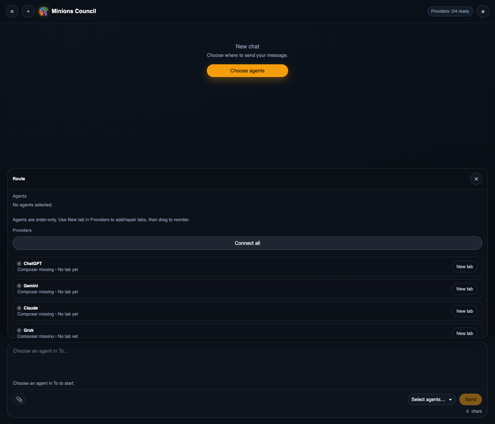
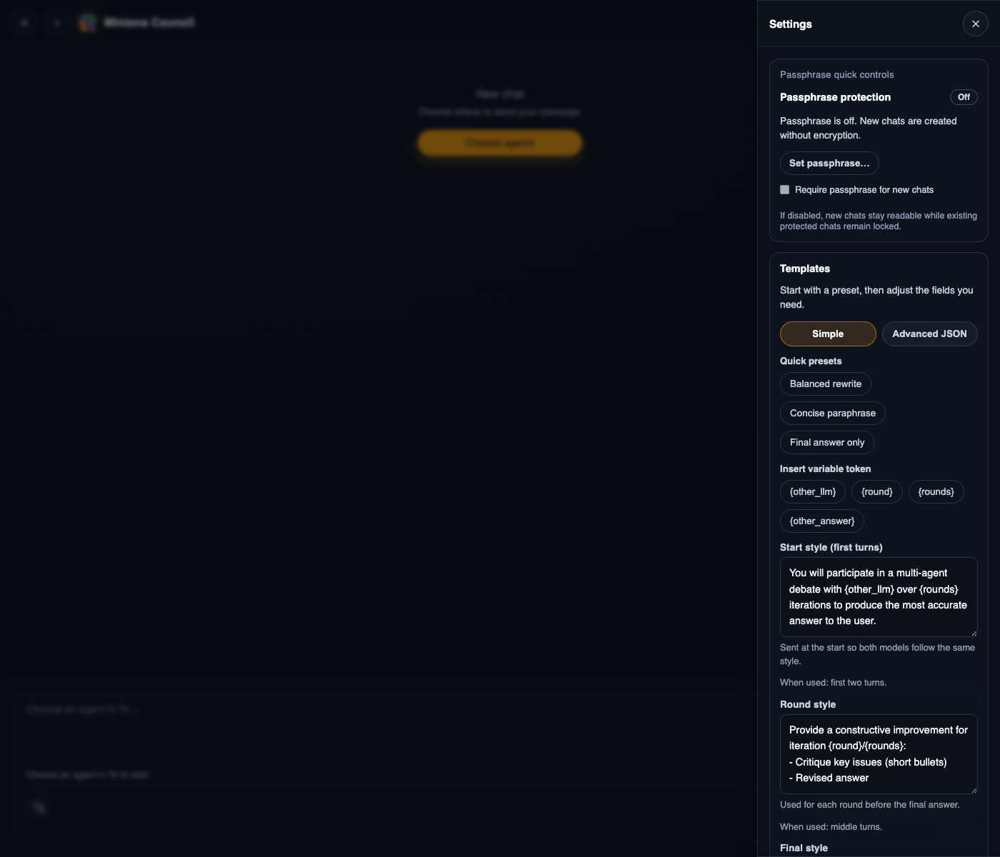

# Multi Agent Council

<p align="center">
  
</p>

Compare and debate ChatGPT, Claude, Gemini, and Grok from one extension workspace, directly in your web browser.

Inspired by the LLM Council idea, Multi Agent Council runs through vendor websites in your browser instead of through APIs or a relay backend. That means no API spend, no extra middleware, no giving up the native provider experience, and support for provider-native features like file attachments where automation is available.

## What It Does

Multi Agent Council is a Chrome extension for cross-checking important questions across provider websites you already use.

- `Single`: send to one agent when you want one fast answer from one model.
- `Compare`: send the same prompt to multiple agents in parallel to see agreement and disagreement.
- `Debate`: run multi-round round-robin exchanges so models can challenge and refine each other.
- `Tab Profiles`: use multiple tabs from the same provider when you want duplicate agents or separate contexts.
- `Attachments`: append files in the side panel and send them to supported provider chats with provider-specific upload automation.
- `Local encrypted history`: chats stay on-device, and protected chats can be encrypted locally with a passphrase.

On Chrome, clicking the extension icon opens the side panel. On Arc, the extension tries the side panel first and falls back to an extension tab when the panel does not materialize. There is no popup UI.

## Why This Exists

When a question matters, one polished answer is usually the wrong stopping point. LLMs are often better at spotting weak assumptions, missing edge cases, and shaky reasoning after the first draft than at avoiding every mistake on the first pass. Multi Agent Council is built around that reality.

- `Cross-checking over one-shot trust`: compare independent answers before you act.
- `Diversity over monoculture`: different providers bring different priors, retrieval behavior, style biases, refusal patterns, and strengths.
- `Debate over isolated answers`: later turns let one model challenge or refine another model's reasoning.
- `Consensus with dissent preserved`: the goal is not forced unanimity, but a clearer map of where answers agree, disagree, and still need verification.

## When To Use It

Use it when the answer matters, bias or narrow framing is costly, or multiple independent views would raise your confidence.

- Choosing a surgeon, specialist, or other professional where criteria and tradeoffs matter.
- Comparing conflicting medical explanations after several appointments, or uploading a report or scan to prepare sharper follow-up questions for clinicians.
- Pressure-testing research, hiring, product, or strategy questions before you commit.
- Sanity-checking everyday decisions where taste and perspective matter, like picking the best place for a date in Paris.

Multi Agent Council helps you compare perspectives and ask better questions. It does not replace licensed professional judgment, medical advice, or ordinary due diligence.

## Why Browser-Native Matters

- `No API spend`: use the provider tabs and accounts you already have.
- `Native provider UX`: keep attachments, model pickers, reasoning modes, and other vendor-specific web features.
- `File attachments`: add files once in the side panel; supported providers receive them in their own chat UI when automation is available.
- `No relay backend`: prompts stay between your browser session and the provider websites.
- `Real multi-tab workflows`: run multiple profiles of the same provider when you want duplicate agents or separate contexts.
- `Passphrase-protected history`: protected chats are encrypted locally at rest, and the unlock key lives only in browser session storage.

## Before You Install From Source

If you install the published Chrome Web Store build, you do not need Node.js or Developer mode. The steps below are for running the extension from the repository.

You need:

- Google Chrome, Chromium, or Arc with extension developer mode enabled.
- Node.js and npm to build the generated runtime files.
- Active logins for whichever providers you want to use:
    - ChatGPT
    - Claude
    - Gemini
    - Grok

You do not need API keys.

## Install From Source

### 1. Clone and build

```bash
git clone https://github.com/AmT42/agent-council-browser.git
cd agent-council-browser
npm ci
npm run build:src
```

### 2. Package a clean extension folder (recommended)

Loading the repository root works, but the browser then treats your whole source tree as the
extension. Instead, pack only the runtime files into a separate folder:

```bash
npm run pack:extension -- --out="E:\edge-extensions\multi-agent-council"
```

```bash
# WSL / macOS / Linux
npm run pack:extension -- --out=/mnt/e/edge-extensions/multi-agent-council
```

The command:

- builds `src/` into the root runtime files,
- regenerates `variant-icons/` if the icon set is missing,
- copies only the allowlisted extension files (see `scripts/release/release-allowlist.txt`),
- refuses to pack into the repository itself, and
- verifies every file referenced by `manifest.json` exists.

Useful flags: `--mode=dev` (keeps the branch label in `version_name`), `--no-build`, `--name="My Name"`,
`--keep`. Forward slashes also work: `--out=E:/edge-extensions/multi-agent-council`.

### 3. Load it in Chrome or Edge

1. Open `chrome://extensions/` (Edge: `edge://extensions/`).
2. Turn on `Developer mode`.
3. Click `Load unpacked`.
4. Select the packaged folder from step 2, e.g. `E:\edge-extensions\multi-agent-council`.
5. Pin `Multi Agent Council` if you want one-click access.
6. Click the extension icon to open the UI.
   - Chrome and Edge open the side panel.
   - Arc may open the side panel or fall back to an extension tab running `sidepanel.html`.

### 4. Rebuild when the source changes

The source of truth lives under `src/`. The root runtime files and the packaged folder are generated.

After you change source files:

```bash
npm run pack:extension -- --out="E:\edge-extensions\multi-agent-council"
```

Then go back to `chrome://extensions/` and click `Reload` on the unpacked extension.

## First Look

Fresh install state in the side panel:



What you are seeing:

- The route builder is the main control surface.
- `Connect all` bootstraps one default agent per supported provider.
- `New tab` creates an extra tab profile for that provider.
- The composer stays disabled until the selected route is valid and connected.


## Real Usage Capture

The repo now includes a dedicated Playwright workflow for capturing a real end-to-end example from authenticated provider tabs.

The intended gallery is:

- sidepanel ready to send a 4-agent, 1-round debate,
- one real output screenshot from ChatGPT,
- one real output screenshot from Gemini,
- one real output screenshot from Claude,
- one real output screenshot from Grok,
- and the final sidepanel transcript after the session ends.

One-time setup:

```bash
npm run docs:screenshots:setup
```

That opens a dedicated Chromium profile at `.playwright-profiles/readme-capture/` and waits for all four providers to become ready.

After that profile is logged into ChatGPT, Gemini, Claude, and Grok:

```bash
npm run docs:screenshots
```

The capture command reuses the same dedicated profile and waits for the real extension session to finish before writing screenshots.

## Settings, History, And Templates

The settings drawer contains:

- Passphrase setup for protected chats.
- Local encryption for protected history at rest.
- Locking for protected chats; unlock keys live only in browser session storage.
- Prompt template editing for debate/direct flows.
- Danger-zone actions for resetting or clearing local history.



## Provider Behavior

| Provider | Prompt send                                 | Attachments                                               |
| -------- | ------------------------------------------- | --------------------------------------------------------- |
| ChatGPT  | Automated via provider UI                   | Best-effort auto-upload                                   |
| Claude   | Automated via provider UI and debugger path | Best-effort auto-upload                                   |
| Gemini   | Automated via provider UI                   | No auto-upload; text-only if files are attached           |
| Grok     | Automated via provider UI                   | Best-effort auto-upload, fallback to text-only if blocked |

Attachment notes:

- Attachments are stored in memory for the active session only.
- Attachments are delivered once per agent per session.
- Supported providers receive files through their own chat UI, not through a separate file API.
- If a provider requires manual upload, the UI warns you before the run proceeds.

## Troubleshooting

### `Send` is disabled

Check these first:

- Your prompt is not empty.
- At least one agent is selected.
- Required provider tabs are connected.
- Debate routes have a valid round count.

### A provider says `Composer missing`, `Wrong host`, or `Login required`

Open that provider tab, make sure you are on the correct site, and sign in if needed. Then return to the side panel and use `Reconnect`, `New tab`, or `Connect all`.

### The app looks stale after code changes

Run:

```bash
npm run pack:extension -- --out="E:\edge-extensions\multi-agent-council"
```

Then reload the unpacked extension in `chrome://extensions/` or `edge://extensions/`.

## Development

Useful commands:

```bash
npm run build:src
npm run lint
npm run test:unit
npm run test:integration
npm run test:e2e:smoke
```

README screenshots are generated from the live unpacked extension with Playwright:

```bash
npm run docs:screenshots:setup
npm run docs:screenshots
```

## Privacy And Security

- Chats are stored locally on your device.
- Protected chats can be encrypted locally at rest with a passphrase.
- Unlock keys are kept in browser session storage and cleared when the browser session resets or when you lock protected chats.
- The project does not run a prompt-relay backend.
- Provider interactions happen through the provider websites in your browser session.

See:

- [PRIVACY.md](PRIVACY.md)
- [SECURITY.md](SECURITY.md)
- [SUPPORT.md](SUPPORT.md)

## More Internal Docs

- [docs/architecture.md](docs/architecture.md)
- [docs/release-runbook.md](docs/release-runbook.md)
- [docs/chrome-web-store-submission.md](docs/chrome-web-store-submission.md)

## License

MIT ([LICENSE](LICENSE))
