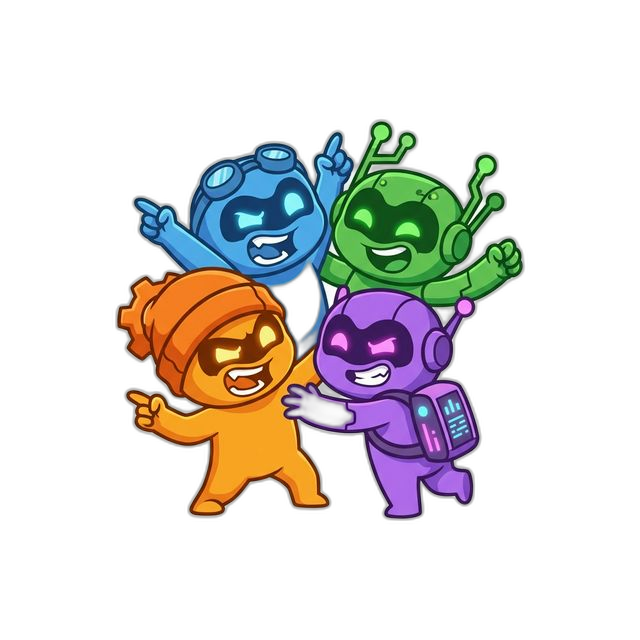

# Minions Council

<p align="center">
  
</p>

No API middleman. Just your LLM council.

Minions Council is a Chrome extension that lets you run prompts across multiple LLM provider websites directly from one side panel, compare outputs, and run structured debate rounds.

## What Is an LLM Council?

An LLM council is a workflow where multiple models review the same user request and each other’s answers so you can:

- cross-check correctness,
- reduce single-model blind spots,
- get higher-confidence final outputs for coding, research, and writing.

In this project, a council is represented as a route of agents. Each agent is a provider plus a browser tab profile.

## How This Differs from `karpathy/llm-council`

Reference project: [karpathy/llm-council](https://github.com/karpathy/llm-council)

Both projects use the same core idea (multiple LLMs evaluating the same task), but the implementation model is different.

| Area              | `karpathy/llm-council`       | Minions Council                                      |
| ----------------- | ---------------------------- | ---------------------------------------------------- |
| Execution path    | API-first orchestration      | Browser-tab orchestration                            |
| Credentials       | API keys                     | Your existing logged-in provider sessions            |
| Cost model        | API billing                  | No additional API relay layer from this project      |
| Runtime location  | Script/service process       | Chrome side panel + provider tabs                    |
| Attachments path  | API-compatible payloads      | Provider UI automation / provider-native upload flow |
| Operational focus | Programmatic API experiments | Practical day-to-day usage directly in provider UIs  |

Practical implication: Minions Council is optimized for people who already work in provider websites and want a coordinated council workflow without building or paying for an API middleware layer.

## Core Capabilities

- Single route: send to one agent.
- Compare route (parallel): send the same prompt to multiple agents at once.
- Debate route: multi-round, round-robin exchange across agents.
- Multiple same-provider agents using separate tab profiles.
- Provider support: ChatGPT, Claude, Gemini, Grok.
- Side panel-first UX with route builder and readiness gating.
- Local-first chat history with optional passphrase protection.
- Attachment support with provider-specific behavior:
    - ChatGPT: best-effort auto-upload.
    - Claude: best-effort auto-upload.
    - Grok: best-effort auto-upload, fallback to text-only when blocked.
    - Gemini: manual upload path (text-only prompt is sent from side panel when attachments are present).

## Installation (Load Unpacked)

1. Clone this repository.
2. Build generated runtime files:

```bash
npm ci
npm run build:src
```

3. Open `chrome://extensions/`.
4. Enable Developer mode.
5. Click `Load unpacked` and select the repository root.
6. Pin `Minions Council` and open the side panel.

## Usage Flow

1. Open side panel.
2. Click the `To` route pill and choose `Single`, `Compare`, or `Debate`.
3. Add and order agents (provider + profile).
4. Connect providers/tabs when prompted (`Connect` / `Connect all` / `New tab`).
5. Send prompt.
6. Review transcript and continue as needed.

## Architecture Overview

Source of truth lives under `src/` and generates runtime files in repo root.

- `src/background/`: service worker orchestration, session engine, tab profiles.
- `src/content/`: provider-page capture/send logic.
- `src/sidepanel/`: side panel app (HTML/CSS/JS).
- `src/history/`: local history and passphrase encryption helpers.
- `src/manifest/manifest.base.json`: manifest source.

Build output (generated): `manifest.json`, `background.js`, `contentScript.js`, `sidepanel.js`, `historyStore.js`, etc.

Canonical behavior documentation lives in `AGENTS.md`.

## Security and Privacy

- Local-first storage (IndexedDB) for chat history.
- Optional passphrase-based encryption for protected chats.
- No project-operated relay backend for prompt forwarding.
- Provider interactions happen through provider websites in your browser session.

See:

- `PRIVACY.md`
- `SECURITY.md`
- `SUPPORT.md`

## Development

### Build and tests

```bash
npm run build:src
npm run lint
npm run format:check
npm run test:unit
npm run test:integration
npm run test:e2e:smoke
```

### Release artifact

```bash
npm run build:release
```

Output:

- `release/minions-council-v<version>.zip`

Release process docs:

- `docs/production-readiness.md`
- `docs/release-runbook.md`

## Contributing

PRs are welcome. Use branch + PR workflow with CI and review gates enabled.

Useful references:

- `docs/branch-protection.md`
- `docs/codex-pr-pipeline.md`

## License

MIT (`LICENSE`)
