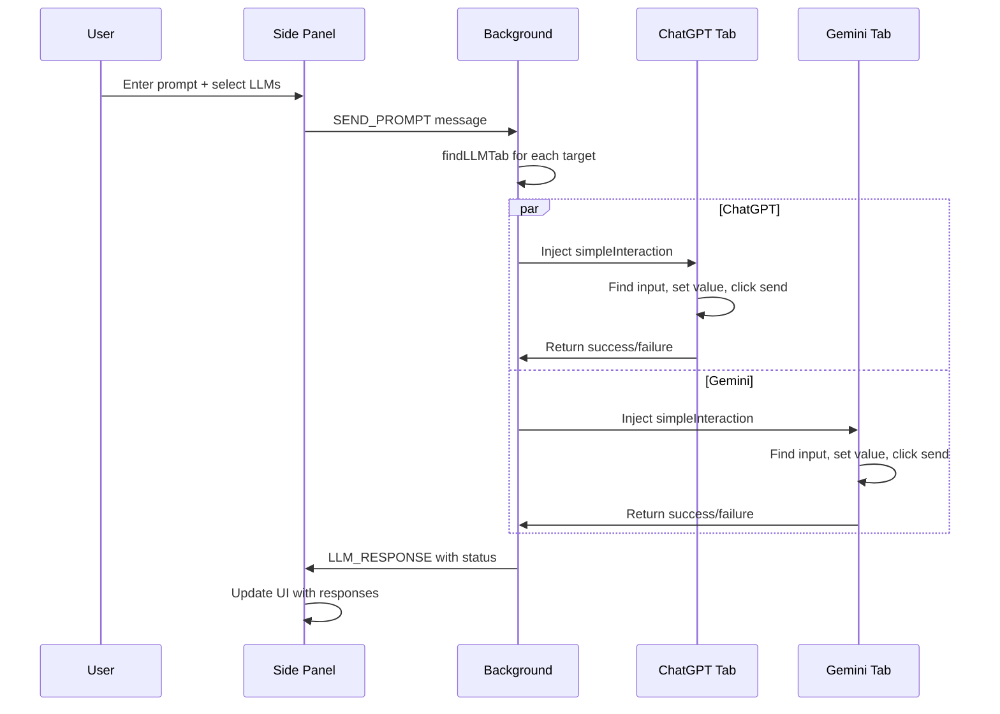
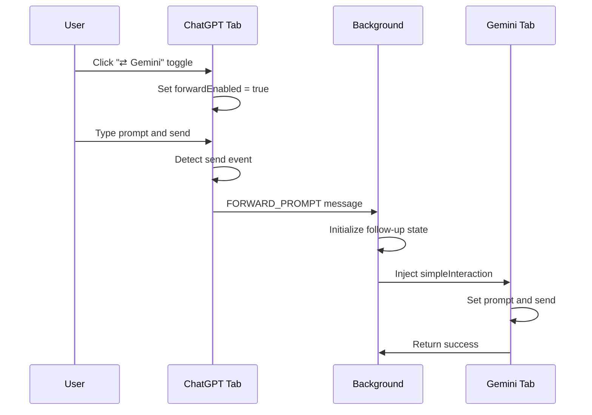
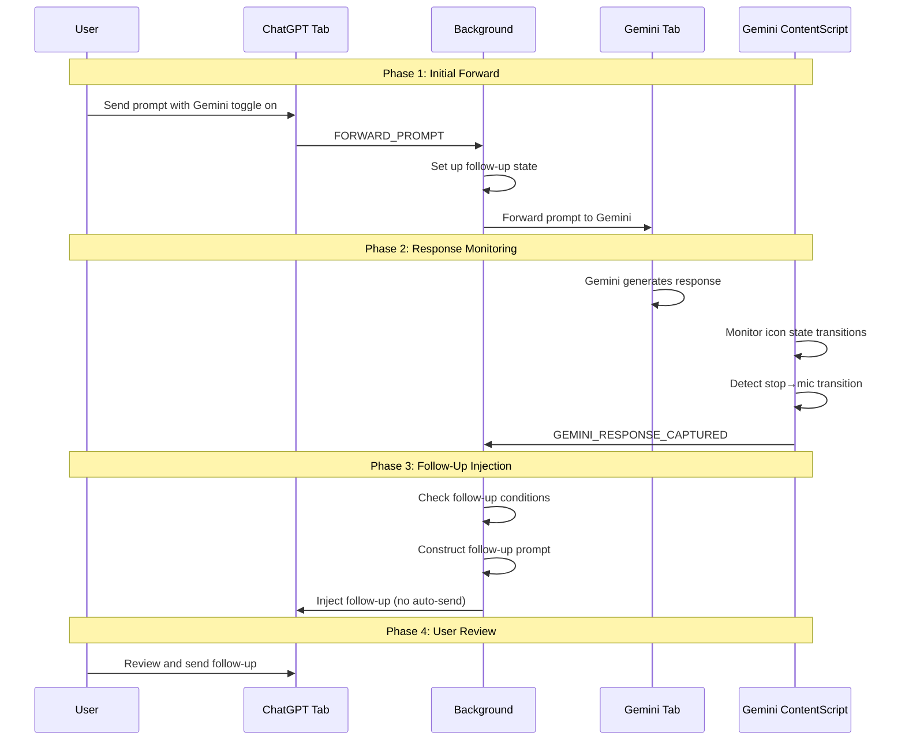

# Multi-LLM Coder Chrome Extension - Advanced Technical Guide

## Table of Contents
1. [Overview & Purpose](#overview--purpose)
2. [Architecture Deep Dive](#architecture-deep-dive)
3. [Core Technical Mechanisms](#core-technical-mechanisms)
4. [Communication Flows](#communication-flows)
5. [Provider-Specific Implementation Details](#provider-specific-implementation-details)
6. [Auto-Follow-Up Feature Technical Details](#auto-follow-up-feature-technical-details)
7. [Adding New Providers - Complete Guide](#adding-new-providers---complete-guide)
8. [Advanced Troubleshooting & Debugging](#advanced-troubleshooting--debugging)
9. [Security Considerations](#security-considerations)
10. [Performance Optimization](#performance-optimization)

---

## Overview & Purpose

The Multi-LLM Coder Chrome Extension is designed to bridge the gap between multiple AI language models, enabling seamless communication and comparison between different providers. The core purpose is to:

1. **Enable Cross-Platform AI Conversations**: Send prompts from one LLM to another for comparison and enhancement
2. **Automate Comparative Analysis**: Automatically gather responses from multiple LLMs for side-by-side comparison
3. **Facilitate AI-Enhanced Workflows**: Use one AI's response to prompt another for iterative improvement
4. **Provide a Unified Interface**: Single side panel for managing multiple AI conversations

### Key Innovation: Auto-Follow-Up System

The extension's most sophisticated feature is the auto-follow-up system, which:
- Detects when a prompt is sent from ChatGPT to Gemini
- Monitors both LLMs' response completion
- Automatically constructs a comparative follow-up prompt
- Injects the follow-up into ChatGPT for user review and sending

---

## Architecture Deep Dive

### Core Components Overview

```
┌─────────────────┐    ┌─────────────────┐    ┌─────────────────┐
│   Side Panel    │    │  Background.js  │    │ Content Scripts │
│  (UI Control)   │◄──►│ (Coordinator)   │◄──►│  (LLM Pages)   │
└─────────────────┘    └─────────────────┘    └─────────────────┘
        │                       │                       │
        │                       │                       │
   ┌────▼────┐            ┌────▼────┐            ┌────▼────┐
   │ User    │            │ Tab     │            │ DOM     │
   │ Input   │            │ Mgmt    │            │ Inject  │
   └─────────┘            └─────────┘            └─────────┘
```

### Manifest V3 Structure

The extension uses Manifest V3 architecture with:
- **Service Worker** (`background.js`): Non-persistent, event-driven coordinator
- **Content Scripts** (`contentScript.js`): Injected into LLM pages for DOM manipulation
- **Side Panel** (`sidepanel.html/js`): Persistent UI for multi-LLM interaction

### Permission Model

```json
{
  "permissions": [
    "sidePanel",    // Chrome side panel API
    "scripting",    // Script injection into tabs
    "storage",      // Extension settings storage
    "tabs"          // Tab management and communication
  ],
  "host_permissions": [
    "*://*.openai.com/*",      // ChatGPT access
    "*://*.chatgpt.com/*",     // ChatGPT alternative domains
    "*://*.gemini.google.com/*" // Gemini access
  ]
}
```

---

## Core Technical Mechanisms

### 1. Cross-Tab Communication System

The extension implements a sophisticated message passing system:

#### Message Types and Flow

```javascript
// Content Script → Background
FORWARD_PROMPT: {
  from: 'chatgpt' | 'gemini',
  prompt: string,
  timestamp: number
}

// Background → Content Script (via injection)
NEW_PROMPT_SENT: {
  promptId: string,
  timestamp: number
}

// Content Script → Background (Gemini only)
GEMINI_RESPONSE_CAPTURED: {
  content: string,
  promptId: string,
  timestamp: number,
  responseDelay: number
}

// Side Panel ↔ Background
SEND_PROMPT: {
  prompt: string,
  targetLLMs: string[]
}
```

#### State Management in Background Script

```javascript
// Auto-follow-up state tracking
let activeFollowUpState = {
  originalPrompt: null,
  originalSourceLLM: null,
  originalChatGPTTabId: null,
  chatGPTResponseAcknowledged: false,
  geminiResponseContentForFollowUp: null,
  geminiResponseScraped: false,
  promptId: null,
  timestamp: null
};
```

### 2. DOM Injection and Manipulation Techniques

#### Finding Input Elements (Multi-Strategy Approach)

```javascript
function findInput() {
  const selectors = isChatGPT ? [
    '#prompt-textarea',                    // Primary ChatGPT selector
    'textarea[data-testid="prompt-textarea"]', // Fallback with test ID
    'textarea[placeholder*="Message"]',    // Placeholder-based fallback
    'textarea',                           // Generic textarea
    '[contenteditable="true"]'            // ContentEditable fallback
  ] : [
    'div.ql-editor[role="textbox"]',      // Primary Gemini selector
    '.ql-editor.textarea',                // Alternative Gemini
    'div[contenteditable="true"][aria-label*="prompt"]', // Aria-label based
    'textarea[placeholder*="Enter a prompt"]', // Placeholder fallback
    'textarea',                           // Generic
    '[contenteditable="true"]'            // ContentEditable fallback
  ];
  
  for (const sel of selectors) {
    const el = document.querySelector(sel);
    if (el) return el;
  }
  return null;
}
```

#### Setting Input Values (Framework-Aware)

```javascript
// ChatGPT (React-based) - requires native setter
if (llmType === 'chatgpt' && inputElement.tagName === 'TEXTAREA') {
  const nativeInputValueSetter = Object.getOwnPropertyDescriptor(
    window.HTMLTextAreaElement.prototype, 'value'
  ).set;
  
  if (nativeInputValueSetter) {
    nativeInputValueSetter.call(inputElement, prompt);
  } else {
    inputElement.value = prompt;
  }
  
  // Trigger React's event system
  inputElement.dispatchEvent(new Event('input', { bubbles: true, composed: true }));
  inputElement.dispatchEvent(new Event('change', { bubbles: true, composed: true }));
}

// Gemini (ContentEditable-based)
else if (inputElement.isContentEditable || inputElement.contentEditable === 'true') {
  document.execCommand('selectAll', false, null);
  document.execCommand('insertText', false, prompt);
  inputElement.dispatchEvent(new Event('input', { bubbles: true, composed: true }));
}
```

### 3. Response Detection System

#### Gemini Response Completion Detection (Icon State Method)

```javascript
function getCurrentIconState() {
  const micIcon = document.querySelector('mat-icon[fonticon="mic"]');
  const sendIcon = document.querySelector('mat-icon[fonticon="send"]:not(.hidden)');
  const stopIcon = document.querySelector('mat-icon[fonticon="stop"]');
  
  if (stopIcon) return 'stop';    // Currently generating
  if (micIcon) return 'mic';      // Ready for input (complete)
  if (sendIcon) return 'send';    // Text typed but not sent
  return 'unknown';
}

function isResponseComplete() {
  const currentIconState = getCurrentIconState();
  
  // Detect transition from 'stop' to 'mic' - indicates completion
  if (lastIconState === 'stop' && currentIconState === 'mic') {
    // Wait 500ms for stabilization before capturing
    iconTransitionTimeout = setTimeout(() => {
      if (!captureComplete) {
        const responseText = getResponseText();
        if (responseText) {
          chrome.runtime.sendMessage({
            type: 'GEMINI_RESPONSE_CAPTURED',
            content: responseText,
            promptId: currentPromptId,
            timestamp: Date.now()
          });
        }
      }
    }, 500);
    
    return false; // Don't capture immediately
  }
  
  lastIconState = currentIconState;
  return currentIconState === 'mic' && pendingPromptTimestamp > 0;
}
```

#### Response Text Extraction (Multi-Strategy)

```javascript
function getResponseText() {
  // Strategy 1: Direct message elements (latest only)
  const messages = document.querySelectorAll('[data-message-id], [data-message-author="gemini"]');
  if (messages.length > 0) {
    const lastMessage = messages[messages.length - 1];
    if (!lastMessage.classList.contains('user-message')) {
      const text = lastMessage.innerText || lastMessage.textContent;
      if (text && text.trim()) return text.trim();
    }
  }
  
  // Strategy 2: Markdown content (latest only)
  const markdownElements = document.querySelectorAll('.markdown, .markdown-content');
  if (markdownElements.length > 0) {
    const lastMarkdown = markdownElements[markdownElements.length - 1];
    const isUserMessage = lastMarkdown.closest('[data-author-is-user="true"]');
    if (!isUserMessage) {
      const text = lastMarkdown.innerText || lastMarkdown.textContent;
      if (text && text.trim()) return text.trim();
    }
  }
  
  // Strategy 3: Conversation turns (reverse iteration)
  const conversationTurns = document.querySelectorAll('.conversation-turn, .message-container');
  for (let i = conversationTurns.length - 1; i >= 0; i--) {
    const turn = conversationTurns[i];
    if (!turn.classList.contains('user-message')) {
      const text = turn.innerText || turn.textContent;
      if (text && text.trim()) return text.trim();
    }
  }
  
  return '';
}
```

---

## Communication Flows

### Flow 1: Side Panel Multi-LLM Prompt



### Flow 2: In-Page Forwarding (ChatGPT → Gemini)



### Flow 3: Auto-Follow-Up Complete Cycle



---

## Provider-Specific Implementation Details

### ChatGPT Integration

#### DOM Structure Characteristics
- **Framework**: React-based SPA with virtual DOM
- **Input Element**: `<textarea id="prompt-textarea">`
- **Send Button**: `<button data-testid="send-button">`
- **Challenge**: React's synthetic event system requires native setters

#### Specific Techniques
```javascript
// Input value setting for React
const nativeInputValueSetter = Object.getOwnPropertyDescriptor(
  window.HTMLTextAreaElement.prototype, 'value'
).set;
nativeInputValueSetter.call(inputElement, prompt);

// Event triggering for React recognition
inputElement.dispatchEvent(new Event('input', { bubbles: true, composed: true }));
inputElement.dispatchEvent(new KeyboardEvent('keydown', { 
  key: ' ', keyCode: 32, bubbles: true, composed: true 
}));
```

#### Toggle Button Placement Strategy
```javascript
// ChatGPT: Place near send button in form container
if (sendBtnEl) {
  parentElement = sendBtnEl.parentElement;
  const buttonContainer = sendBtnEl.closest(
    'div[class*="stretch"] > div[class*="flex"], div[class*="absolute"] > div[class*="flex"]'
  );
  if (buttonContainer) parentElement = buttonContainer;
}
```

### Gemini Integration

#### DOM Structure Characteristics
- **Framework**: Angular/Material Design components
- **Input Element**: `<div class="ql-editor" role="textbox" contenteditable="true">`
- **Send Button**: `<button aria-label="Send message">`
- **Challenge**: ContentEditable requires different text insertion methods

#### Specific Techniques
```javascript
// ContentEditable text insertion
document.execCommand('selectAll', false, null);
document.execCommand('insertText', false, prompt);

// Alternative method for newer browsers
if (document.queryCommandSupported && document.queryCommandSupported('insertText')) {
  document.execCommand('insertText', false, prompt);
} else {
  inputElement.innerText = prompt;
}
```

#### Response Detection - Icon State System
```javascript
// Gemini uses Material Icons to indicate state
const iconStates = {
  mic: 'mat-icon[fonticon="mic"]',      // Ready for input
  send: 'mat-icon[fonticon="send"]',    // Text entered, ready to send
  stop: 'mat-icon[fonticon="stop"]'     // Currently generating
};

// State transition detection is the most reliable method
function detectCompletion() {
  if (lastState === 'stop' && currentState === 'mic') {
    // Response completed - wait 500ms for stability
    setTimeout(captureResponse, 500);
  }
}
```

---

## Auto-Follow-Up Feature Technical Details

### State Management Architecture

The auto-follow-up feature uses a sophisticated state tracking system:

```javascript
const defaultFollowUpState = {
  originalPrompt: null,
  originalSourceLLM: null,
  originalChatGPTTabId: null,
  chatGPTResponseAcknowledged: false,
  geminiResponseContentForFollowUp: null,
  geminiResponseScraped: false,
  promptId: null,
  timestamp: null,
  waitingForResponse: false
};

let activeFollowUpState = { ...defaultFollowUpState };
```

### Prompt-Response Pairing System

To ensure responses match the correct prompts:

```javascript
// Generate unique ID for each prompt
function generatePromptId() {
  return `prompt_${Date.now()}_${Math.random().toString(36).substr(2, 9)}`;
}

// Track prompt-response lifecycle
function initializeFollowUp(prompt, sourceTabId) {
  const promptId = generatePromptId();
  
  activeFollowUpState = {
    ...defaultFollowUpState,
    originalPrompt: prompt,
    originalSourceLLM: 'chatgpt',
    originalChatGPTTabId: sourceTabId,
    promptId: promptId,
    timestamp: Date.now(),
    waitingForResponse: true
  };
  
  return promptId;
}
```

### Response Validation and Timing

```javascript
function validateResponse(message) {
  // Ensure response belongs to current prompt cycle
  if (message.promptId !== activeFollowUpState.promptId) {
    console.log('Response promptId mismatch, ignoring');
    return false;
  }
  
  // Ensure enough time has passed since prompt was sent
  const minResponseTime = 2000; // 2 seconds minimum
  const responseDelay = Date.now() - activeFollowUpState.timestamp;
  if (responseDelay < minResponseTime) {
    console.log('Response too quick, likely cached/previous response');
    return false;
  }
  
  // Ensure we're still waiting for a response
  if (!activeFollowUpState.waitingForResponse) {
    console.log('Not waiting for response, ignoring');
    return false;
  }
  
  return true;
}
```

### Follow-Up Prompt Construction

```javascript
function constructFollowUpPrompt(geminiResponse) {
  return `I also asked Gemini the same question here's his answer:

${geminiResponse}

Could you read your answer and his answer to see if you can enhance yours or if everything's good.`;
}

// Injection without auto-send
async function injectFollowUpIntoChatGPT(tabId, promptText) {
  const results = await chrome.scripting.executeScript({
    target: { tabId: tabId },
    func: simpleInteraction_InjectOnly,
    args: [promptText, 'chatgpt']
  });
  
  if (results?.[0]?.result?.success) {
    console.log('Follow-up prompt injected successfully');
    resetFollowUpState();
  }
}
```

---

## Adding New Providers - Complete Guide

### Overview: What to Consider

When adding a new LLM provider (e.g., Claude/Anthropic, Grok/XAI), you need to:

1. **Analyze the DOM structure** and identify reliable selectors
2. **Understand the framework** (React, Vue, Angular, vanilla JS)
3. **Test input value setting methods** for the specific framework
4. **Implement response detection** mechanisms
5. **Handle framework-specific event systems**
6. **Add provider-specific configurations**

### Step 1: DOM Analysis and Selector Discovery

#### Tools and Techniques
```bash
# Use Chrome DevTools to inspect the provider's page
# Focus on:
# 1. Input elements (textarea, contenteditable div)
# 2. Send buttons 
# 3. Response containers
# 4. Loading/generation indicators
# 5. Message containers for response extraction
```

#### Example Analysis for Claude (Anthropic)
```javascript
// Hypothetical Claude selectors (need real analysis)
const claudeSelectors = {
  input: [
    'textarea[placeholder*="Talk to Claude"]',
    'div[contenteditable="true"][data-testid="chat-input"]',
    'textarea.chat-input',
    'div.prompt-input[contenteditable="true"]'
  ],
  sendButton: [
    'button[data-testid="send-button"]',
    'button[aria-label*="Send"]',
    'button.send-btn',
    'form button[type="submit"]'
  ],
  responseContainer: [
    '.message.assistant',
    '.claude-response',
    '[data-role="assistant"]',
    '.ai-message'
  ],
  loadingIndicator: [
    '.loading-dots',
    '.generating-indicator',
    'button[aria-label*="Stop"]'
  ]
};
```

### Step 2: Framework Detection and Input Methods

#### Framework Detection Techniques
```javascript
function detectFramework(url) {
  // Check for framework indicators
  if (window.React || document.querySelector('[data-reactroot]')) {
    return 'react';
  }
  if (window.Vue || document.querySelector('[data-v-]')) {
    return 'vue';
  }
  if (window.angular || document.querySelector('[ng-app]')) {
    return 'angular';
  }
  return 'vanilla';
}

// Framework-specific input value setting
function setInputValue(element, value, framework) {
  switch (framework) {
    case 'react':
      return setReactInputValue(element, value);
    case 'vue':
      return setVueInputValue(element, value);
    case 'angular':
      return setAngularInputValue(element, value);
    default:
      return setVanillaInputValue(element, value);
  }
}
```

#### Provider-Specific Input Setting Methods
```javascript
function setClaudeInputValue(inputElement, prompt) {
  // Claude-specific implementation
  if (inputElement.tagName === 'TEXTAREA') {
    // If Claude uses textarea
    const nativeInputValueSetter = Object.getOwnPropertyDescriptor(
      window.HTMLTextAreaElement.prototype, 'value'
    ).set;
    
    if (nativeInputValueSetter) {
      nativeInputValueSetter.call(inputElement, prompt);
    } else {
      inputElement.value = prompt;
    }
    
    // Claude-specific events
    inputElement.dispatchEvent(new Event('input', { bubbles: true }));
    inputElement.dispatchEvent(new Event('change', { bubbles: true }));
    
  } else if (inputElement.contentEditable === 'true') {
    // If Claude uses contenteditable
    inputElement.focus();
    document.execCommand('selectAll', false, null);
    document.execCommand('insertText', false, prompt);
    
    // Alternative modern approach
    if (!document.execCommand('insertText', false, prompt)) {
      inputElement.innerText = prompt;
      inputElement.dispatchEvent(new Event('input', { bubbles: true }));
    }
  }
}
```

### Step 3: Response Detection Implementation

#### Generic Response Detection Pattern
```javascript
function createResponseDetector(providerConfig) {
  return {
    // Detection method 1: Loading indicator disappearance
    isGenerationComplete() {
      const loadingIndicators = providerConfig.loadingIndicators
        .map(sel => document.querySelector(sel))
        .filter(el => el);
      return loadingIndicators.length === 0;
    },
    
    // Detection method 2: Content stability
    hasContentStabilized(stableChecks = 3) {
      const currentContent = this.getLatestResponse();
      if (currentContent === this.lastContent) {
        this.stabilityCounter++;
      } else {
        this.stabilityCounter = 0;
        this.lastContent = currentContent;
      }
      return this.stabilityCounter >= stableChecks;
    },
    
    // Detection method 3: Provider-specific indicators
    checkProviderSpecificCompletion() {
      // Override for each provider
      return true;
    },
    
    // Combined detection logic
    isResponseComplete() {
      return this.isGenerationComplete() && 
             this.hasContentStabilized() && 
             this.checkProviderSpecificCompletion();
    }
  };
}
```

#### Claude-Specific Response Detection
```javascript
function createClaudeResponseDetector() {
  const detector = createResponseDetector(claudeConfig);
  
  // Override provider-specific completion check
  detector.checkProviderSpecificCompletion = function() {
    // Claude-specific completion indicators
    const stopButton = document.querySelector('button[aria-label*="Stop generating"]');
    if (stopButton) return false;
    
    const inputEnabled = document.querySelector('textarea:not([disabled])') || 
                        document.querySelector('[contenteditable="true"]:not([aria-disabled="true"])');
    if (!inputEnabled) return false;
    
    // Check for Claude's "thinking" or processing indicators
    const thinkingIndicator = document.querySelector('.claude-thinking, .processing-indicator');
    if (thinkingIndicator) return false;
    
    return true;
  };
  
  return detector;
}
```

### Step 4: Provider Integration in Core Files

#### 1. Update manifest.json
```json
{
  "host_permissions": [
    "*://*.openai.com/*",
    "*://*.chatgpt.com/*",
    "*://*.gemini.google.com/*",
    "*://*.anthropic.com/*",     // Add Claude
    "*://*.claude.ai/*",         // Claude alternative domain
    "*://x.ai/*",                // Add Grok
    "*://*.grok.com/*"           // Grok alternative domain
  ]
}
```

#### 2. Update contentScript.js
```javascript
// Add provider detection
const host = location.hostname;
const isChatGPT = host.includes('openai.com') || host.includes('chatgpt.com');
const isGemini = host.includes('gemini.google.com');
const isClaude = host.includes('anthropic.com') || host.includes('claude.ai');
const isGrok = host.includes('x.ai') || host.includes('grok.com');

if (!isChatGPT && !isGemini && !isClaude && !isGrok) return;

// Determine current and target LLMs
let currentLLM, forwardTo;
if (isChatGPT) {
  currentLLM = 'chatgpt';
  forwardTo = 'gemini'; // or make this configurable
} else if (isGemini) {
  currentLLM = 'gemini';
  forwardTo = 'chatgpt';
} else if (isClaude) {
  currentLLM = 'claude';
  forwardTo = 'chatgpt'; // or 'gemini'
} else if (isGrok) {
  currentLLM = 'grok';
  forwardTo = 'chatgpt';
}
```

#### 3. Update findInput() with provider selectors
```javascript
function findInput() {
  const selectors = {
    chatgpt: [
      '#prompt-textarea',
      'textarea[data-testid="prompt-textarea"]',
      'textarea[placeholder*="Message"]'
    ],
    gemini: [
      'div.ql-editor[role="textbox"]',
      '.ql-editor.textarea',
      'div[contenteditable="true"][aria-label*="prompt"]'
    ],
    claude: [
      'textarea[placeholder*="Talk to Claude"]',
      'div[contenteditable="true"][data-testid="chat-input"]',
      'textarea.chat-input'
    ],
    grok: [
      'textarea[placeholder*="Ask Grok"]',
      'div[contenteditable="true"].grok-input',
      'textarea.prompt-input'
    ]
  };
  
  const currentSelectors = selectors[currentLLM] || [];
  for (const sel of currentSelectors) {
    const el = document.querySelector(sel);
    if (el) return el;
  }
  return null;
}
```

#### 4. Update background.js simpleInteraction
```javascript
function simpleInteraction(prompt, llmType) {
  const inputSelectors = {
    'chatgpt': ['#prompt-textarea', 'textarea[data-testid="prompt-textarea"]'],
    'gemini': ['div.ql-editor[role="textbox"]', '.ql-editor.textarea'],
    'claude': ['textarea[placeholder*="Talk to Claude"]', 'div[contenteditable="true"][data-testid="chat-input"]'],
    'grok': ['textarea[placeholder*="Ask Grok"]', 'div[contenteditable="true"].grok-input']
  };
  
  const sendButtonSelectors = {
    'chatgpt': ['button[data-testid="send-button"]', 'button[aria-label="Send message"]'],
    'gemini': ['button[aria-label="Send message"]', 'button[data-testid="send-button"]'],
    'claude': ['button[data-testid="send-button"]', 'button[aria-label*="Send"]'],
    'grok': ['button.send-button', 'button[aria-label*="Send"]']
  };
  
  // Provider-specific input value setting
  if (llmType === 'chatgpt' && inputElement.tagName === 'TEXTAREA') {
    // React-specific method
    setReactInputValue(inputElement, prompt);
  } else if (llmType === 'gemini' && inputElement.contentEditable === 'true') {
    // Gemini contenteditable method
    setGeminiInputValue(inputElement, prompt);
  } else if (llmType === 'claude') {
    // Claude-specific method
    setClaudeInputValue(inputElement, prompt);
  } else if (llmType === 'grok') {
    // Grok-specific method
    setGrokInputValue(inputElement, prompt);
  }
}
```

### Step 5: Response Capture Implementation

#### Add Provider-Specific Response Detection
```javascript
// In contentScript.js for Claude
if (isClaude) {
  function observeClaudeResponses() {
    const detector = createClaudeResponseDetector();
    
    function checkForResponse() {
      if (detector.isResponseComplete()) {
        const responseText = getClaudeResponseText();
        if (responseText && responseText !== lastResponseText) {
          chrome.runtime.sendMessage({
            type: 'CLAUDE_RESPONSE_CAPTURED',
            content: responseText,
            promptId: currentPromptId,
            timestamp: Date.now()
          });
          lastResponseText = responseText;
        }
      }
    }
    
    // Use MutationObserver + interval checking
    const observer = new MutationObserver(checkForResponse);
    observer.observe(document.body, {
      childList: true,
      subtree: true,
      characterData: true
    });
    
    setInterval(checkForResponse, 2000);
  }
  
  function getClaudeResponseText() {
    // Strategy 1: Message containers
    const messages = document.querySelectorAll('.message.assistant, .claude-response, [data-role="assistant"]');
    if (messages.length > 0) {
      const lastMessage = messages[messages.length - 1];
      return lastMessage.innerText || lastMessage.textContent;
    }
    
    // Strategy 2: Response content areas
    const responseContent = document.querySelector('.response-content:last-child, .ai-message:last-child');
    if (responseContent) {
      return responseContent.innerText || responseContent.textContent;
    }
    
    return '';
  }
  
  setTimeout(observeClaudeResponses, 3000);
}
```

### Step 6: Auto-Follow-Up Extension for New Providers

#### Extend Follow-Up Logic for Multiple Providers
```javascript
// In background.js - extend handleForwardPrompt
function handleForwardPrompt(message, sender) {
  const { from, prompt } = message;
  const promptId = generatePromptId();
  
  // Support auto-follow-up from any provider to any provider
  if (from === 'chatgpt' || from === 'claude' || from === 'grok') {
    // Initialize follow-up state for providers that support it
    activeFollowUpState = {
      ...defaultFollowUpState,
      originalPrompt: prompt,
      originalSourceLLM: from,
      originalSourceTabId: sender.tab.id,
      promptId: promptId,
      timestamp: Date.now(),
      waitingForResponse: true
    };
  }
  
  // Determine target based on source
  const targetMap = {
    'chatgpt': 'gemini',
    'gemini': 'chatgpt',
    'claude': 'chatgpt',  // or make configurable
    'grok': 'gemini'      // or make configurable
  };
  
  const target = targetMap[from];
  if (target) {
    processLLM(target, prompt, promptId);
  }
}

// Handle responses from all providers
function handleProviderResponse(message, sender) {
  const { type, content, promptId } = message;
  
  // Map response types to providers
  const responseProviderMap = {
    'GEMINI_RESPONSE_CAPTURED': 'gemini',
    'CLAUDE_RESPONSE_CAPTURED': 'claude',
    'GROK_RESPONSE_CAPTURED': 'grok'
  };
  
  const responseProvider = responseProviderMap[type];
  if (responseProvider && validateResponse(message)) {
    // Store response and check if follow-up is ready
    activeFollowUpState.targetResponseContent = content;
    activeFollowUpState.targetResponseProvider = responseProvider;
    activeFollowUpState.responseScraped = true;
    
    triggerFollowUpIfReady();
  }
}
```

### Step 7: Configuration and Settings

#### Provider Configuration Object
```javascript
const PROVIDER_CONFIGS = {
  chatgpt: {
    name: 'ChatGPT',
    domains: ['openai.com', 'chatgpt.com'],
    inputSelectors: ['#prompt-textarea', 'textarea[data-testid="prompt-textarea"]'],
    sendButtonSelectors: ['button[data-testid="send-button"]'],
    framework: 'react',
    inputMethod: 'nativeSetter',
    responseSelectors: ['.message[data-author="assistant"]'],
    supportsFollowUp: true
  },
  gemini: {
    name: 'Gemini',
    domains: ['gemini.google.com'],
    inputSelectors: ['div.ql-editor[role="textbox"]'],
    sendButtonSelectors: ['button[aria-label="Send message"]'],
    framework: 'angular',
    inputMethod: 'contentEditable',
    responseSelectors: ['.markdown, .markdown-content'],
    responseDetectionMethod: 'iconState',
    iconSelectors: {
      stop: 'mat-icon[fonticon="stop"]',
      ready: 'mat-icon[fonticon="mic"]'
    },
    supportsFollowUp: false, // Provides responses TO other providers
    supportsResponseCapture: true
  },
  claude: {
    name: 'Claude',
    domains: ['anthropic.com', 'claude.ai'],
    inputSelectors: ['textarea[placeholder*="Talk to Claude"]'],
    sendButtonSelectors: ['button[data-testid="send-button"]'],
    framework: 'react', // or whatever Claude uses
    inputMethod: 'nativeSetter',
    responseSelectors: ['.message.assistant', '.claude-response'],
    supportsFollowUp: true,
    supportsResponseCapture: true
  }
};
```

---

## Advanced Troubleshooting & Debugging

### Debugging Tools and Techniques

#### 1. Console Logging Strategy
```javascript
// Comprehensive logging for development
const DEBUG = true; // Set to false for production

function debugLog(component, message, data = null) {
  if (!DEBUG) return;
  
  const timestamp = new Date().toISOString();
  const prefix = `[MLC ${component}] ${timestamp}`;
  
  if (data) {
    console.log(`${prefix} ${message}:`, data);
  } else {
    console.log(`${prefix} ${message}`);
  }
}

// Usage throughout codebase
debugLog('ContentScript', 'Input element found', inputElement);
debugLog('Background', 'Follow-up state updated', activeFollowUpState);
debugLog('GeminiCapture', 'Icon state transition', { from: lastState, to: currentState });
```

#### 1.1. Race Condition Debugging
```javascript
// Specific debugging for response detection race conditions
function debugRaceCondition(promptText, responseText, timingData) {
  console.group(`[MLC RaceCondition Debug] Prompt: "${promptText.substring(0, 50)}..."`);
  
  console.log('Timing Analysis:', {
    promptSentAt: new Date(timingData.promptTimestamp).toISOString(),
    responseDetectedAt: new Date(timingData.responseTimestamp).toISOString(),
    responseDelay: timingData.responseTimestamp - timingData.promptTimestamp,
    isQuickResponse: (timingData.responseTimestamp - timingData.promptTimestamp) < 1000
  });
  
  console.log('Response Analysis:', {
    responseLength: responseText.length,
    wordCount: responseText.split(/\s+/).length,
    startsWithInvalidPattern: /^(I'm thinking|Loading|Please wait)/i.test(responseText),
    responsePreview: responseText.substring(0, 100)
  });
  
  console.log('State Analysis:', {
    lastResponseText: timingData.lastResponseText ? timingData.lastResponseText.substring(0, 50) : 'null',
    isDifferentFromLast: responseText !== timingData.lastResponseText,
    iconStateTransition: `${timingData.lastIconState} → ${timingData.currentIconState}`
  });
  
  console.groupEnd();
}

// Use in response detection:
debugRaceCondition(currentPrompt, responseText, {
  promptTimestamp: pendingPromptTimestamp,
  responseTimestamp: Date.now(),
  lastResponseText,
  lastIconState,
  currentIconState: getCurrentIconState()
});
```

#### 2. Selector Testing Utility
```javascript
// Inject into any LLM page for testing
function testSelectors(providerConfig) {
  console.log(`Testing selectors for ${providerConfig.name}:`);
  
  // Test input selectors
  console.log('Input selectors:');
  providerConfig.inputSelectors.forEach((selector, index) => {
    const element = document.querySelector(selector);
    console.log(`  ${index + 1}. ${selector}: ${element ? 'FOUND' : 'NOT FOUND'}`);
    if (element) console.log('    Element:', element);
  });
  
  // Test send button selectors
  console.log('Send button selectors:');
  providerConfig.sendButtonSelectors.forEach((selector, index) => {
    const element = document.querySelector(selector);
    console.log(`  ${index + 1}. ${selector}: ${element ? 'FOUND' : 'NOT FOUND'}`);
    if (element) console.log('    Element:', element);
  });
  
  // Test response selectors
  console.log('Response selectors:');
  providerConfig.responseSelectors.forEach((selector, index) => {
    const elements = document.querySelectorAll(selector);
    console.log(`  ${index + 1}. ${selector}: ${elements.length} found`);
    if (elements.length > 0) console.log('    Elements:', elements);
  });
}

// Use in DevTools console:
// testSelectors(PROVIDER_CONFIGS.claude);
```

#### 3. State Monitoring Dashboard
```javascript
// Add to background.js for debugging
function createDebugDashboard() {
  let debugWindow = null;
  
  return {
    update() {
      if (!debugWindow || debugWindow.closed) {
        debugWindow = window.open('', 'MLC_Debug', 'width=600,height=400');
        debugWindow.document.write(`
          <html>
            <head><title>MLC Debug Dashboard</title></head>
            <body>
              <h2>Multi-LLM Coder Debug Dashboard</h2>
              <div id="content"></div>
              <script>
                window.updateContent = function(html) {
                  document.getElementById('content').innerHTML = html;
                };
              </script>
            </body>
          </html>
        `);
      }
      
      const debugInfo = `
        <h3>Follow-Up State</h3>
        <pre>${JSON.stringify(activeFollowUpState, null, 2)}</pre>
        
        <h3>Recent Messages</h3>
        <pre>${JSON.stringify(recentMessages.slice(-5), null, 2)}</pre>
        
        <h3>Active Tabs</h3>
        <pre>${JSON.stringify(activeTabs, null, 2)}</pre>
      `;
      
      debugWindow.updateContent(debugInfo);
    }
  };
}

// Usage: const debugDashboard = createDebugDashboard();
// Call debugDashboard.update() whenever state changes
```

### Common Issues and Solutions

#### 1. Response Detection Race Condition Bug (Short vs Long Messages)

**Bug Description**: 
A critical timing issue was discovered where short prompts would trigger capture of the previous Gemini response instead of waiting for the new response. This happened because:

- **Short prompts**: Gemini responds very quickly (< 1 second), causing the icon state transition detection to potentially catch the tail end of a previous response completion
- **Long prompts**: Take longer for Gemini to process, giving proper time for state reset and detection

**Root Causes**:
1. **Insufficient minimum response time validation**: The original 500ms delay wasn't enough to distinguish between old and new responses
2. **Icon state pollution**: Previous icon transitions could interfere with new prompt detection
3. **Inadequate response content validation**: No checks to ensure captured response was actually new and different

**Solution Implemented**:
```javascript
// Enhanced timing validation with minimum response time
const minResponseTime = 1000; // Minimum 1 second for any response
const timeSincePrompt = now - pendingPromptTimestamp;

if (timeSincePrompt < minResponseTime) {
    console.log(`Transition too quick (${timeSincePrompt}ms), ignoring - likely previous response`);
    return false;
}

// Dynamic stability delay based on response speed
const stabilityDelay = timeSincePrompt < 3000 ? 1500 : 500; // Longer delay for quick responses

// Enhanced response content validation
function validateResponseContent(responseText) {
    // Check if response is different from last captured
    if (responseText === lastResponseText) return false;
    
    // Validate minimum length and word count
    if (!responseText || responseText.length < 10) return false;
    
    const wordCount = responseText.split(/\s+/).length;
    if (wordCount < 3) return false;
    
    // Check for invalid response patterns
    const invalidPatterns = [
        /^I'm thinking\.\.\./i,
        /^Loading\.\.\./i,
        /^\d{1,2}:\d{2}/, // timestamps
        /^(Yesterday|Today|Just now)/i // metadata
    ];
    
    return !invalidPatterns.some(pattern => pattern.test(responseText));
}

// Complete state reset on new prompt
function resetStateForNewPrompt() {
    captureComplete = false;
    isCapturing = false;
    stableCounter = 0;
    lastIconState = null; // Critical: reset icon state tracking
    
    // Clear any pending timeouts from previous prompts
    if (iconTransitionTimeout) {
        clearTimeout(iconTransitionTimeout);
        iconTransitionTimeout = null;
    }
}
```

**Testing Strategy**:
```javascript
// Test cases to verify the fix
const testCases = [
    { prompt: "Short", expectedBehavior: "Wait for new response, not previous" },
    { prompt: "Medium length prompt here", expectedBehavior: "Normal capture timing" },
    { prompt: "Very long prompt that takes time to process...", expectedBehavior: "Standard response detection" },
    { prompt: "Yo! What's up?".repeat(10), expectedBehavior: "Must wait for actual new response" }
];
```

**Key Lessons**:
- Always validate response timing with minimum thresholds
- Reset all state variables when starting new prompt detection
- Implement content validation to prevent capturing stale responses
- Use dynamic delays based on response characteristics

#### 2. Selector Failures
```javascript
// Robust selector fallback system
function findElementWithFallbacks(selectors, description) {
  for (let i = 0; i < selectors.length; i++) {
    try {
      const element = document.querySelector(selectors[i]);
      if (element) {
        debugLog('SelectorSuccess', `${description} found with selector ${i + 1}/${selectors.length}`, selectors[i]);
        return element;
      }
    } catch (error) {
      debugLog('SelectorError', `Invalid selector: ${selectors[i]}`, error);
    }
  }
  
  debugLog('SelectorFailure', `${description} not found with any selector`);
  return null;
}
```

#### 2. Framework Event System Issues
```javascript
// Comprehensive event triggering
function triggerInputEvents(element, framework) {
  const events = {
    common: ['input', 'change'],
    react: ['input', 'change', 'keydown', 'keyup'],
    vue: ['input', 'change', 'keydown'],
    angular: ['input', 'change', 'keydown', 'focus', 'blur']
  };
  
  const eventsToTrigger = [...events.common, ...(events[framework] || [])];
  
  eventsToTrigger.forEach(eventType => {
    try {
      const event = new Event(eventType, { bubbles: true, cancelable: true });
      element.dispatchEvent(event);
    } catch (error) {
      debugLog('EventError', `Failed to trigger ${eventType}`, error);
    }
  });
}
```

#### 3. Response Detection Race Conditions
```javascript
// Debounced response detection
function createDebouncedDetector(detectFn, delay = 1000) {
  let timeoutId = null;
  let lastResult = null;
  
  return function(...args) {
    clearTimeout(timeoutId);
    
    timeoutId = setTimeout(() => {
      const result = detectFn.apply(this, args);
      if (result !== lastResult) {
        lastResult = result;
        debugLog('ResponseDetection', 'State changed', result);
      }
    }, delay);
  };
}
```

---

## Security Considerations

### Content Security Policy (CSP) Compliance

#### Safe Script Injection
```javascript
// Avoid eval() and inline scripts
function safeScriptInjection(code, tabId) {
  // Instead of injecting string code, inject pre-defined functions
  return chrome.scripting.executeScript({
    target: { tabId },
    func: predefinedFunction,
    args: [safeParameters]
  });
}

// Never do this:
// chrome.scripting.executeScript({
//   target: { tabId },
//   code: `eval("${userInput}")` // DANGEROUS
// });
```

#### Input Sanitization
```javascript
function sanitizePrompt(prompt) {
  // Remove potentially dangerous characters/scripts
  return prompt
    .replace(/<script\b[^<]*(?:(?!<\/script>)<[^<]*)*<\/script>/gi, '') // Remove script tags
    .replace(/javascript:/gi, '') // Remove javascript: protocols
    .replace(/on\w+\s*=/gi, '') // Remove event handlers
    .trim();
}
```

### Privacy Protection

#### Data Handling
```javascript
// Never store sensitive data permanently
function handleSensitiveData(data) {
  // Process immediately and discard
  const processedData = processData(data);
  
  // Clear from memory
  data = null;
  
  return processedData;
}

// Use session storage for temporary data only
function storeTemporarily(key, value, maxAge = 300000) { // 5 minutes default
  const item = {
    value,
    timestamp: Date.now(),
    maxAge
  };
  
  sessionStorage.setItem(key, JSON.stringify(item));
  
  // Auto-cleanup
  setTimeout(() => {
    sessionStorage.removeItem(key);
  }, maxAge);
}
```

---

## Performance Optimization

### Efficient DOM Monitoring

#### Optimized MutationObserver
```javascript
function createOptimizedObserver(callback, options = {}) {
  const defaultOptions = {
    childList: true,
    subtree: true,
    attributes: false, // Only if needed
    characterData: false, // Only if needed
    attributeOldValue: false,
    characterDataOldValue: false
  };
  
  const config = { ...defaultOptions, ...options };
  
  let observerCallback = callback;
  
  // Throttle callback to prevent excessive firing
  if (options.throttle) {
    let throttleTimeout = null;
    observerCallback = (mutations, observer) => {
      if (throttleTimeout) return;
      
      throttleTimeout = setTimeout(() => {
        callback(mutations, observer);
        throttleTimeout = null;
      }, options.throttle);
    };
  }
  
  return new MutationObserver(observerCallback);
}
```

#### Smart Event Listening
```javascript
function addSmartEventListener(element, eventType, handler, options = {}) {
  const { debounce = 0, throttle = 0 } = options;
  
  let processedHandler = handler;
  
  if (debounce > 0) {
    let debounceTimeout = null;
    processedHandler = (...args) => {
      clearTimeout(debounceTimeout);
      debounceTimeout = setTimeout(() => handler.apply(this, args), debounce);
    };
  } else if (throttle > 0) {
    let throttleTimeout = null;
    processedHandler = (...args) => {
      if (throttleTimeout) return;
      throttleTimeout = setTimeout(() => {
        handler.apply(this, args);
        throttleTimeout = null;
      }, throttle);
    };
  }
  
  element.addEventListener(eventType, processedHandler, options);
  
  return () => element.removeEventListener(eventType, processedHandler);
}
```

### Memory Management

#### Cleanup Utilities
```javascript
class ResourceManager {
  constructor() {
    this.resources = new Set();
  }
  
  addObserver(observer, target, config) {
    observer.observe(target, config);
    this.resources.add(() => observer.disconnect());
    return observer;
  }
  
  addEventListener(element, type, handler, options) {
    element.addEventListener(type, handler, options);
    this.resources.add(() => element.removeEventListener(type, handler));
  }
  
  addInterval(callback, delay) {
    const intervalId = setInterval(callback, delay);
    this.resources.add(() => clearInterval(intervalId));
    return intervalId;
  }
  
  cleanup() {
    this.resources.forEach(cleanupFn => {
      try {
        cleanupFn();
      } catch (error) {
        console.error('Cleanup error:', error);
      }
    });
    this.resources.clear();
  }
}

// Usage in content scripts
const resourceManager = new ResourceManager();

// Add cleanup on page unload
window.addEventListener('beforeunload', () => {
  resourceManager.cleanup();
});
```

---

## Conclusion

This advanced technical guide provides a comprehensive foundation for understanding, extending, and maintaining the Multi-LLM Coder Chrome Extension. The modular architecture and detailed implementation patterns make it straightforward to add new AI providers while maintaining reliability and performance.

### Key Takeaways for Adding New Providers:

1. **DOM Analysis is Critical**: Spend time understanding each provider's unique DOM structure and framework
2. **Framework-Aware Input Handling**: Each framework (React, Angular, Vue) requires specific input value setting techniques
3. **Robust Response Detection**: Implement multiple detection strategies with fallbacks
4. **Comprehensive Testing**: Test selectors, event triggering, and response capture thoroughly
5. **Performance Considerations**: Use throttling, debouncing, and proper cleanup to maintain performance
6. **Security First**: Always sanitize inputs and follow CSP guidelines

The extension's success lies in its adaptability to different LLM provider implementations while maintaining a consistent user experience across all supported platforms.